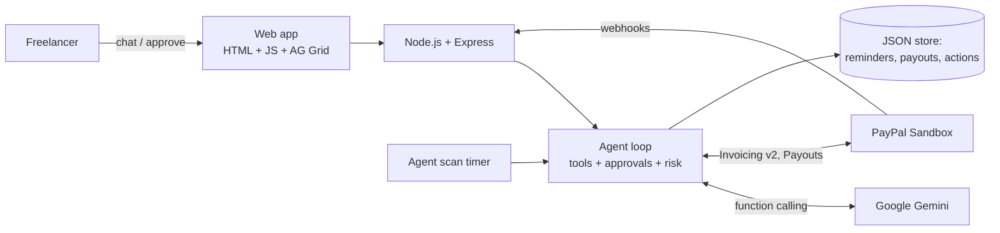

# Kaasu: the AI agent that gets freelancers paid

> *Kaasu* means "money" in Tamil.

Kaasu is an AI accounts-receivable agent for freelancers and small businesses. You talk to it in plain English, and it creates real **PayPal invoices**, chases late payers with the right tone at the right time, predicts who will pay late, and automatically **splits incoming payments with collaborators via PayPal Payouts**. A human approves every action that emails a client or moves money.

**Live demo:** `https://<your-app>.onrender.com` *(free tier: the first load can take ~1 minute while the server wakes up)*
**Demo video:** `https://youtube.com/...`

---

## The problem

Freelancers lose time and money to late payments. It is rarely because clients refuse to pay. Usually the invoice was forgotten, buried, or never followed up:

- In Bonsai's analysis of invoices from over 100,000 freelancers, **29% were paid late**. ([Bonsai](https://www.hellobonsai.com/blog/late-freelance-payment))
- Clockify's data shows **42% of freelancers have missed personal bills** because of client payment delays, and most late payments resolve after the **first reminder**. ([Plutio summary](https://www.plutio.com/freelancer-magazine/late-invoice-payments))

So the fix isn't another invoicing form. It's an agent that does the boring follow-up work for you, politely and on time, while you stay in control.

## What Kaasu does

| | Feature | How |
|---|---|---|
| 💬 | **Chat to invoice.** *"Bill Priya priya@acme.com $450 for logo design, due Friday."* | Gemini turns the message into a structured call that creates a **PayPal Invoicing v2 draft**. You approve, and PayPal emails the invoice with a pay link. |
| 🤖 | **Proactive payment chaser** | A scheduled agent scan finds invoices that are overdue or due within 2 days, picks a tone (friendly, firm, or final) from days overdue, reminders already sent, and the client's history, then drafts a reminder with Gemini. You can edit it, then approve, and PayPal's **invoice remind API** sends it. |
| 📈 | **Late-payment risk score** | Every open invoice gets an explainable 0–100 score built from the client's past payment behaviour, days overdue, invoice size, and ignored reminders. Hover to see the reasons. |
| 💸 | **Automatic revenue split** | *"…split 30% with ana@writer.com."* When the client pays, Kaasu proposes a **PayPal Payout** for the collaborator's share. The split rule is stored in the PayPal invoice's private memo, so PayPal stays the source of truth. |
| ✨ | **Cash-flow insights** | Outstanding, overdue, paid last 30 days, and a **risk-weighted forecast** of the next 30 days, plus 3 actionable insights written by Gemini from the live numbers. |
| 📊 | **AG Grid dashboard** | Sortable, filterable, quick-searchable invoice table with status pills, risk bars, and one-click actions. |
| 🔗 | **PayPal webhooks** | `INVOICING.*` events update invoice status instantly. Signatures are verified with PayPal's verify API when `PAYPAL_WEBHOOK_ID` is set. |
| ✅ | **Human in the loop** | Sending, reminding, recording payments, and payouts are all queued as approval cards. Payouts are blocked unless the invoice is paid and the total stays within the invoice amount. |

## How PayPal is used

| PayPal API | Used for |
|---|---|
| OAuth 2.0 (`/v1/oauth2/token`) | Server-to-server auth, token cached until expiry |
| Invoicing v2: create draft (`POST /v2/invoicing/invoices`) | Agent creates invoices from chat |
| Invoicing v2: send (`/{id}/send`) | Sent only after user approval |
| Invoicing v2: remind (`/{id}/remind`) | AI-written reminders, user-approved |
| Invoicing v2: record payment (`/{id}/payments`) | Mark offline payments (bank transfer, cash) |
| Invoicing v2: get and list | Sync statuses, rebuild state after restarts |
| Payouts v1 (`POST /v1/payments/payouts`) | Collaborator revenue splits |
| Webhooks + verify signature | Real-time status updates |

All calls use the **free PayPal sandbox**.

## How AI is used (tools)

- **Google Gemini** (`gemini-2.5-flash` by default, free tier from Google AI Studio) via the REST `generateContent` API with **function calling**. The agent has 8 tools: `create_invoice`, `list_invoices`, `find_invoice`, `sync_with_paypal`, `propose_reminder`, `propose_payout`, `propose_mark_paid`, `get_cashflow_insights`. It runs a multi-step loop (up to 6 tool rounds per message).
- Gemini also **writes reminder emails** (tone-aware, using the client's payment history) and **cash-flow insights**.
- **Graceful degradation:** if the AI is unavailable or rate-limited, Kaasu falls back to a rule-based command parser and template reminders, so the app never breaks during a demo.
- **AG Grid Community** renders the invoice dashboard.
- **Render** (free web service) hosts the live demo.

## Architecture



## Run it locally (5 minutes)

**Requirements:** Node.js 18 or newer.

```bash
git clone https://github.com/<you>/kaasu.git
cd kaasu
npm install
cp .env.example .env      # on Windows: copy .env.example .env
# open .env and paste your PayPal sandbox Client ID/Secret and Gemini API key
npm start
```

Open **http://localhost:3000**.

- No keys at all? It still runs in **mock mode** (simulated PayPal, rule-based AI), so you can explore the UI.
- **PayPal keys:** [developer.paypal.com](https://developer.paypal.com) → Apps & Credentials → **Sandbox** → Create App.
- **Gemini key (free):** [aistudio.google.com/apikey](https://aistudio.google.com/apikey).

### Try this demo flow

1. Click **Sample data** to load a realistic payment history (labelled SAMPLE; it is never sent to PayPal).
2. In chat: *"Bill Priya Shah priya@example.com $450 for logo design due Friday, split 30% with ana@example.com"*, then **Approve** the send card.
3. Click **Open in PayPal** on the new invoice, and pay it with your **sandbox personal (buyer) account** (Developer Dashboard → Testing Tools → Sandbox Accounts).
4. Click **⟳ Sync PayPal**. The invoice turns **PAID**, and a **payout card** for Ana's 30% appears. Approve it to send a real sandbox payout.
5. Click **🤖 Run agent scan**. Kaasu drafts tone-appropriate reminders for overdue invoices. Edit one and approve it.
6. Ask *"Who is most likely to pay late and why?"* or *"How's my cash flow?"*

## Deploy for free on Render

1. Push this repo to GitHub.
2. Render → **New → Web Service** → connect the repo. Build `npm install`, start `npm start`, instance type **Free**. (Or use **New → Blueprint** with the included `render.yaml`.)
3. Add the environment variables `PAYPAL_CLIENT_ID`, `PAYPAL_CLIENT_SECRET`, and `GEMINI_API_KEY`.
4. *(Optional)* In the PayPal developer dashboard, add a sandbox webhook to `https://<your-app>.onrender.com/api/webhooks/paypal` for the invoicing events, and set `PAYPAL_WEBHOOK_ID`.

Free Render services sleep when idle and keep no disk between restarts. Kaasu handles this by re-syncing all invoices from PayPal on startup.

## Project structure

```
server.js          Express server + routes + scan timer
src/agent.js       AI agent: tools, approvals, risk scoring, insights, chaser scan
src/paypal.js      PayPal REST client (Invoicing, Payouts, Webhooks) + mock mode
src/ai.js          Gemini REST client (function calling)
src/db.js          Tiny JSON-file store
public/            Front-end (index.html, styles.css, app.js, AG Grid)
```

## Safety design

- The AI can only **propose** actions that email clients or move money. Each one becomes an approval card.
- Payouts are only allowed from **paid** invoices, and can never exceed the invoice total.
- Reminders still waiting for approval are withdrawn automatically when the client pays.
- Secrets stay in `.env` on the server and never reach the browser.

## Limitations and next steps

- Mixed currencies are summed at face value in the KPI cards (no FX conversion yet).
- Next: client-side agent (pay-by-chat), smart payment-plan offers for high-risk invoices, PayPal Agent Toolkit / MCP integration.

## License

[MIT](LICENSE)
